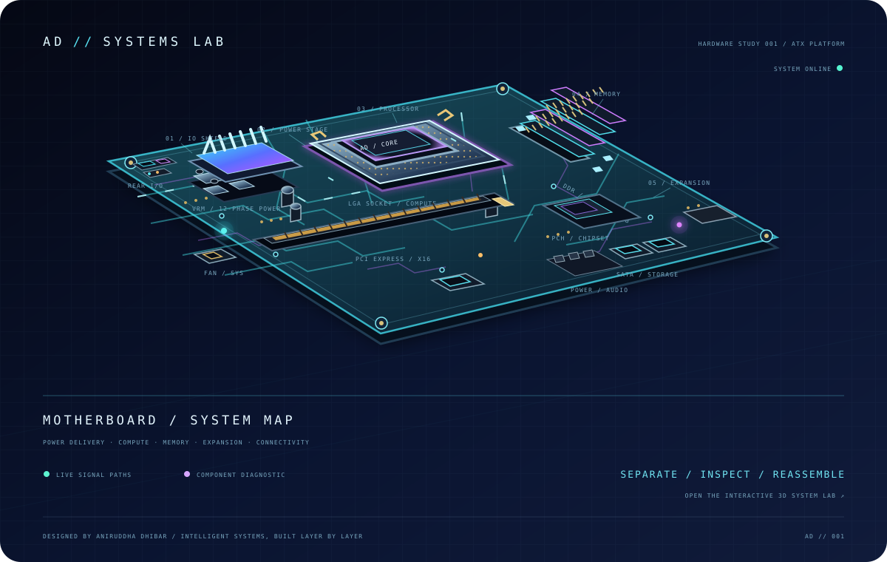

 

---

### SYSTEM / 01 · MOTHERBOARD LAB

PCB SIGNAL PATHS · CPU / MEMORY / VRM / PCIe · ANIMATED HARDWARE STUDY <a href="https://aniruddhadhibar5-bot.github.io/aniruddhadhibar5-bot/">↗ EXPLORE THE INTERACTIVE 3D SYSTEMS LAB</a>

---

### SYSTEM / 02 · PROFILE

I’m Aniruddha Dhibar, a Data Scientist and Software Engineer passionate about building intelligent systems, clean software, and data-driven products. I enjoy working across machine learning, data engineering, backend systems, and modern application development.

| **FOCUS** | **CURRENT DIRECTION** |
|:--|:--|
| **BUILDING** | Intelligent data and ML-powered applications |
| **EXPLORING** | Advanced ML systems, cloud-native engineering, scalable backend architecture |
| **WORKING ACROSS** | Machine learning · data engineering · backend · modern applications |
| **GUIDING IDEA** | Turn raw data into useful, beautiful products |

---

### SYSTEM / 03 · ENGINEERING TOOLKIT

**LANGUAGES**

       

**DATA & MACHINE LEARNING**

     

**WEB & PRODUCT ENGINEERING**

    

**PLATFORMS & TOOLS**

       

---

### SYSTEM / 04 · BUILD PRINCIPLES

- **Useful over ornamental** — solve a real problem and make the result clear.
- **Reliable by design** — favor maintainable code, sensible boundaries, and thoughtful engineering.
- **Curious by default** — connect data, software, and systems, then keep learning by building.

---

DESIGNED WITH INTENT · BUILT LAYER BY LAYER · ANIRUDDHA DHIBAR

